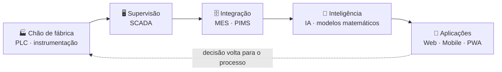

<div align="center">



<br/>

<a href="https://www.linkedin.com/in/gustavomsi/"></a>
<a href="https://gustavolacerda.eng.br"></a>


<br/><br/>


</div>

<br/>

##  Sobre mim

Sou engenheiro eletricista e desenvolvedor, com mais de **20 anos** construindo a ponte entre **automação industrial** e **software**. Já entreguei projetos para **Gerdau**, **ArcelorMittal** e **Votorantim**, liderando equipes multidisciplinares de TI e automação.

```csharp
public sealed class Gustavo : Engenheiro, ILiderDeEquipes
{
    public string Cargo     => "Diretor de Desenvolvimento e Tecnologia";
    public string Empresa   => "MSI Engenharia & Tecnologia";
    public int    Bagagem   => 20; // anos, e contando

    public string[] Formacao =>
    [
        "Engenharia Elétrica",
        "Pós-graduação em Ciência de Dados & Inteligência Artificial",
        "MBA em Marketing Intelligence, Data Analytics e Agile Management (PUC)",
        "Técnico em Automação",
    ];

    public string[] Foco =>
    [
        "Transformação digital na indústria",
        "Integração de sistemas MES / PIMS",
        "IA e modelos matemáticos aplicados ao processo",
        "Liderança de equipes de engenharia de automação",
    ];

    public string Combustivel => "☕";
}
```

##  Caixa de ferramentas

<table>
  <tr>
    <td width="50%" valign="top">
      <h3>💻 Software</h3>
      
      <br/><br/>
      
      
      
    </td>
    <td width="50%" valign="top">
      <h3>🏭 Automação industrial</h3>
      
      
      
      <br/>
      
      
      <br/>
      
      
    </td>
  </tr>
  <tr>
    <td valign="top">
      <h3>🧠 Dados & IA</h3>
      
      
      
      
    </td>
    <td valign="top">
      <h3>🧭 Gestão</h3>
      
      
      
      
    </td>
  </tr>
</table>

##  Onde eu atuo



##  GitHub em números

<div align="center">


<br/>


<br/><br/>

<picture>
  <source media="(prefers-color-scheme: dark)" srcset="https://raw.githubusercontent.com/srqubit/srqubit/output/github-contribution-grid-snake-dark.svg" />
  
</picture>

</div>

<details>
  <summary><b>☕ Curiosidades extras</b></summary>
  <br/>

  - Gosto de um café enquanto faço reviews de código
  - Sempre em busca de novas tecnologias e desafios
  - Nas horas vagas, fã de esportes de tiro e música

</details>

---

<div align="center">

### Quer bater um papo ou trocar uma ideia?

<a href="https://www.linkedin.com/in/gustavomsi/"></a>
<a href="https://gustavolacerda.eng.br"></a>

<br/><br/>

<sub>Boas linhas de código (e boas doses de café) ☕</sub>


</div>
